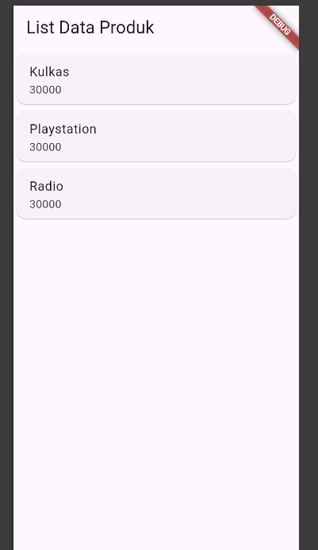
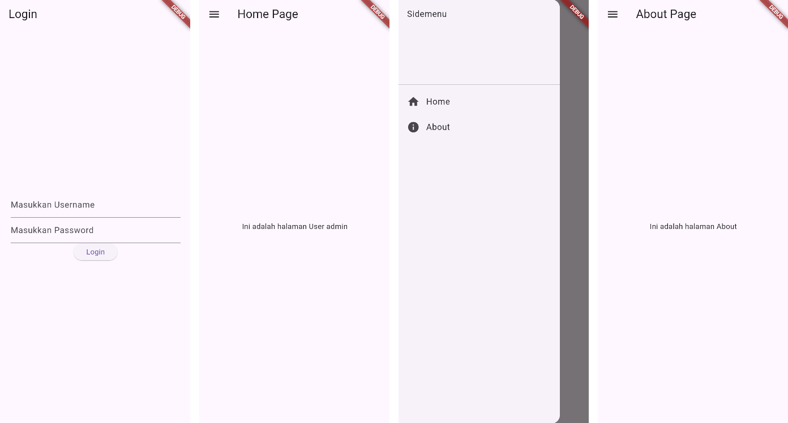
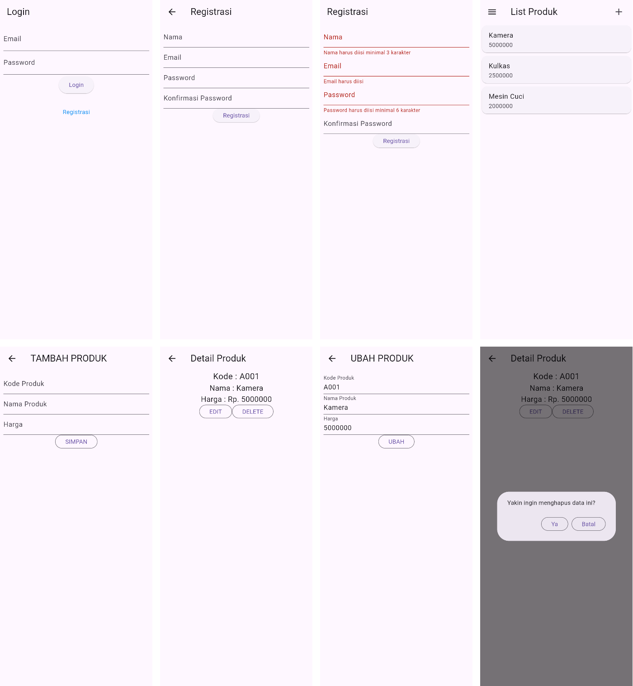

# Laporan Praktikum Pemrograman Mobile (Flutter)

**Nama**        : Ahmad Fikri Zakaria  
**NIM**         : H1D024062  
**Shift**       : Awal B / Akhir C  
**Praktikum**   : Pemrograman Mobile

Materi PDF tersedia di folder [`docs/pdf`](docs/pdf/).

---

## 📝 Tugas Pertemuan 8
**Tanggal**: Selasa, 27 Oktober 2026

**Kesimpulan Praktikum:**  
Pada pertemuan kedelapan, saya mulai membuat aplikasi menggunakan Flutter. Saya mempelajari struktur project Flutter, perbedaan `StatelessWidget` dan `StatefulWidget`, serta cara memisahkan tampilan ke file tersendiri. Saya juga menyusun widget secara vertikal dengan `Column` dan horizontal dengan `Row`. Selanjutnya, saya membuat form produk menggunakan `TextField`, `TextEditingController`, dan `ElevatedButton`, lalu mengirim data ke halaman detail produk menggunakan `Navigator`. Terakhir, saya menampilkan daftar produk dengan `ListView`, `Card`, dan `ListTile`. AppBar pada aplikasi tidak berwarna biru seperti pada modul karena Flutter versi terbaru menggunakan Material 3 sebagai tampilan bawaan.

---

## 📝 Tugas Pertemuan 9
**Tanggal**: Selasa, 3 November 2026

**Kesimpulan Praktikum:**  
Pada pertemuan kesembilan, saya membuat aplikasi Flutter yang memiliki halaman login, side menu, dan penyimpanan lokal. Saya menambahkan package `shared_preferences` pada `pubspec.yaml` untuk menyimpan username di perangkat. Halaman login dibuat dengan `TextField`, `TextEditingController`, dan `ElevatedButton`. Jika username dan password bernilai `admin`, username disimpan ke local storage, lalu muncul `AlertDialog` dan pengguna diarahkan ke halaman Home menggunakan `Navigator.push` dan `MaterialPageRoute`. Halaman Home membaca kembali username dari local storage dan menampilkannya. Selanjutnya, saya membuat side menu dengan `Drawer`, `DrawerHeader`, dan `ListTile` untuk berpindah ke halaman Home dan About. Nama package pada import saya sesuaikan dari `router_flutter` menjadi `belajarflutter`, dan saya menambahkan import `about_page.dart` pada `sidemenu.dart` karena tidak ada di modul. AppBar pada aplikasi tidak berwarna biru seperti pada modul karena Flutter versi terbaru menggunakan Material 3 sebagai tampilan bawaan.

---

## 📝 Tugas Pertemuan 10
**Tanggal**: Selasa, 10 November 2026

**Kesimpulan Praktikum:**  
Pada pertemuan kesepuluh, saya membuat REST API dengan CodeIgniter 4 untuk registrasi, login, dan CRUD produk, lalu mengujinya di Postman. Di Flutter, saya membuat model data serta halaman registrasi, login, list produk, detail produk, dan form tambah/ubah produk yang masih memakai data dummy. AppBar tidak berwarna biru seperti pada modul karena Flutter versi terbaru menggunakan Material 3 sebagai tampilan bawaan.
